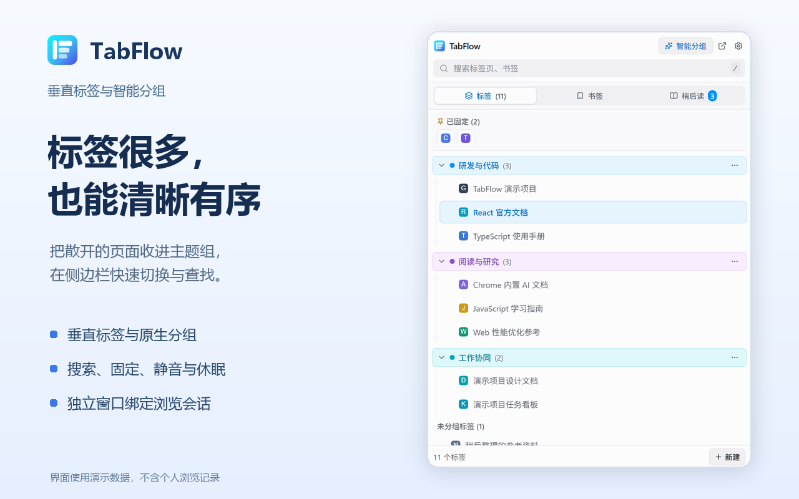
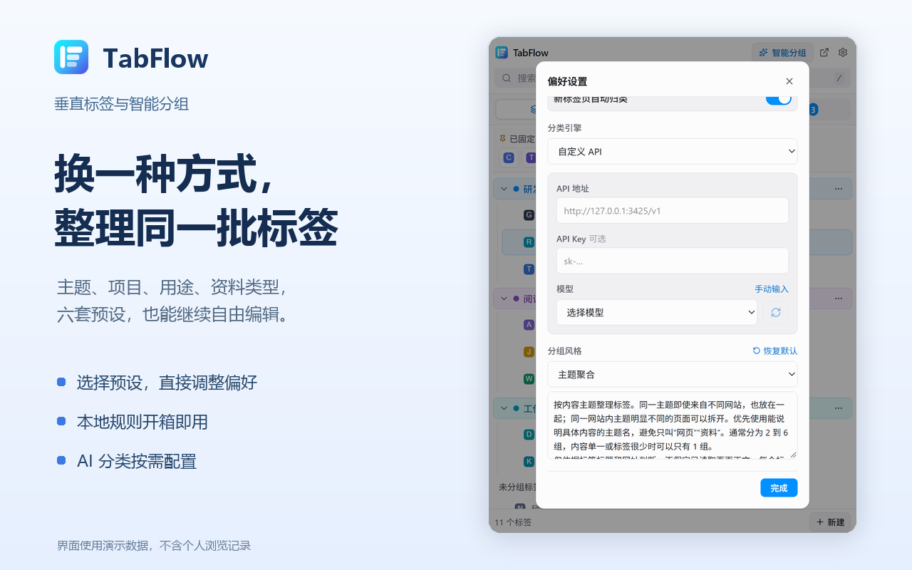
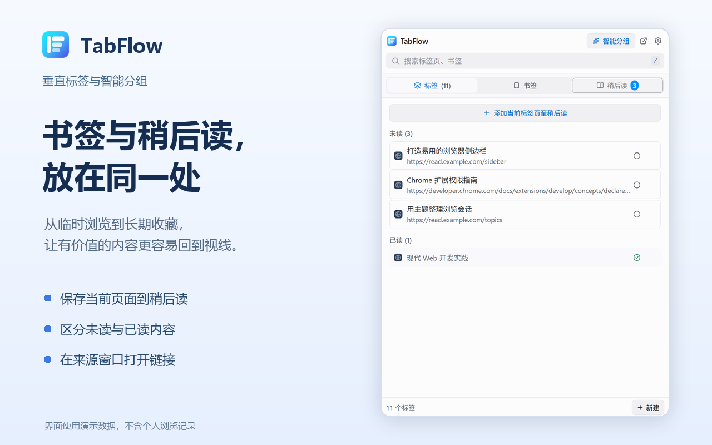

<p align="center">
  
</p>

# TabFlow

**垂直标签与智能分组，让浏览会话更有条理。**

TabFlow 是一个 Chrome 扩展，把标签页、原生标签组、书签和稍后读放进同一个侧边栏。你可以直接使用本地规则整理页面，也可以按需接入模型，或打开独立窗口专注管理当前会话。

**Chrome 120+** · **Manifest V3** · **React + TypeScript** · **ISC License**

[开始使用](#开始使用) · [分类引擎](#分类引擎) · [开发](#开发) · [隐私说明](PRIVACY.md) · [反馈问题](https://github.com/deskid/tabflow/issues)



> 展示图片由实际 React 界面与演示数据制作，不包含个人浏览记录。

## 把浏览任务放在一起

| 功能 | 能做什么 |
| --- | --- |
| 垂直标签 | 搜索、切换、固定、静音和关闭标签，与 Chrome 原生标签组同步 |
| 原生分组 | 修改组名与颜色、折叠或解散分组，将组内标签保存为书签 |
| 自动归类 | 新标签按域名或关键词匹配已有分组，可随时关闭 |
| 智能整理 | 默认使用本地规则，也可选择端侧模型、云端 API 或本机 Codex |
| 书签与稍后读 | 查找和打开书签，保存当前页面，区分已读与未读内容 |
| 独立窗口 | 始终管理打开它的来源窗口，切换焦点后仍保持绑定 |
| 分组撤销 | 在提示有效期内恢复原组名、颜色、折叠状态和标签顺序 |

自动归类使用本地规则，不会因打开新页面而调用模型。模型整理失败时会保留错误说明，并显示实际执行的规则兜底结果；已关闭或移到其他窗口的标签会在撤销时跳过。

## 按你的方式整理

六套可编辑的分组风格，覆盖主题、项目任务、使用场景、资料类型、站点服务和极简收纳。选择预设后可以继续修改提示词，配置会在侧边栏、独立窗口和选项页之间同步。



分组风格供模型分类参考，本地规则按内置逻辑运行。各模型提供商独立保存模型、密钥和接口地址，切换时恢复各自配置。

## 从临时浏览到长期收藏

将值得继续阅读的页面加入稍后读，或把整个标签组保存为书签。书签、阅读列表和当前标签共用一个工作入口，减少在多个页面之间寻找内容。



## 开始使用

### 从源码加载

需要 **Node.js 24+**、**pnpm 11** 和桌面版 **Chrome 120+**。项目固定的 pnpm 版本见 [package.json](package.json)。

```sh
git clone https://github.com/deskid/tabflow.git
cd tabflow
pnpm install --frozen-lockfile
pnpm build
```

1. 打开 `chrome://extensions/`，启用「开发者模式」。
2. 点击「加载未打包的扩展程序」，选择项目的 `dist` 目录。
3. 点击工具栏的 TabFlow 图标打开侧边栏，即可使用标签管理和本地规则分类。

更新源码并重新构建后，在扩展管理页重新加载 TabFlow。已有配置会保留；新安装默认选择本地规则，无需账号、API Key 或 Codex。

### 快捷键

| 操作 | Windows / Linux | macOS |
| --- | --- | --- |
| 打开侧边栏 | `Ctrl+Shift+P` | `Command+Shift+P` |
| 打开独立窗口 | `Ctrl+Shift+E` | `Command+Shift+E` |

若快捷键被占用，可在 `chrome://extensions/shortcuts` 中调整。

## 分类引擎

| 方式 | 适用场景 | 额外准备 |
| --- | --- | --- |
| 本地规则 | 按关键词、域名快速整理，安装后即可使用 | 无 |
| Chrome 端侧模型 | 在支持的设备上进行模型分类 | 检查可用性，按提示下载模型 |
| OpenAI / DeepSeek | 使用对应服务的模型分类 | API Key、模型及所需站点授权 |
| 自定义 API | 连接 OpenAI 兼容服务或本机接口 | 接口地址、模型，以及服务要求的密钥 |
| ChatGPT 订阅（实验） | 通过官方授权使用自己的订阅，浏览器接入原型 | 点击登录授权；尚待真实账户验证 |
| 本机 Codex | 复用官方 Codex CLI 的认证与模型配置 | 单独安装桥接，平台支持见接入说明 |

### Chrome 端侧模型

在偏好设置选择「Chrome 端侧模型」，先检查可用性，再按提示下载资源。打开设置不会自动下载；资源下载完成后，还会运行自检确认模型能否使用。

支持情况取决于 Chrome、硬件、磁盘、网络和模型状态。当前实现使用英文指令和组名，中文输入可能受模型语言能力限制。模型准备需要联网，推理在设备上进行。

### 云端与自定义 API

在偏好设置选择提供商，填写所需密钥和模型。自定义地址可使用 API 根路径，例如 `http://127.0.0.1:3425/v1`，也可填写完整的 `/v1/chat/completions` 地址；本机服务不要求密钥时可留空。

首次连接自定义主机时，点击模型旁的「连接」并授予站点权限。支持模型目录的服务可以刷新列表，也可以手动输入模型 ID。获取目录不会发起分类推理；模型出现在列表中，也不代表一定具备调用额度。

### ChatGPT 订阅（实验）

选择后点击 **Continue with ChatGPT**，尝试通过官方授权使用自己的订阅，无需本机 CLI 或桥接脚本。此浏览器接入原型尚待真实账号验证，当前界面关闭后需要重新登录。测试流程与实现边界见 [订阅接入原型说明](docs/chatgpt-plan.md)。

### 本机 Codex

连接官方 Codex CLI，复用其认证和模型配置；模型可能使用云端服务。桥接配置见 [本机 Codex 接入说明](docs/native-codex.md)。

## 数据与隐私

- 普通标签管理和本地规则分类不向模型服务发送标签内容。扩展没有独立的广告、统计或遥测后端，也不注入读取页面正文的内容脚本。
- 云端 API、订阅与本机 Codex 分类会发送标签 ID、标题、**完整 URL（含 query/hash）**及分组提示词，当前不会自动脱敏。
- 订阅实验接入的登录令牌只在当前界面内存中保留；非令牌的账号注册信息保存在设备本地，不参与设置同步。
- 设置及 API Key 保存在 `chrome.storage.sync`，可能随 Chrome 同步到其他设备；没有额外应用层加密，切换引擎不会清除旧密钥。
- 自定义接口支持 HTTP，HTTP 不提供传输加密；远程服务建议使用 HTTPS。
- 云端响应的标签 ID 校验尚未与端侧模型和本机桥接完全统一。

完整的数据去向、保存与删除方式见 [隐私与数据说明](PRIVACY.md)，也可阅读 [公开隐私页面](https://deskid.github.io/tabflow/privacy.html)。

## 开发

技术栈为 Manifest V3、React、TypeScript、Vite、Tailwind CSS 和 Radix UI Colors。

| 命令 | 用途 |
| --- | --- |
| `pnpm dev` | 启动 Vite 开发服务器 |
| `pnpm build` | 生成可加载的 `dist` 目录 |
| `pnpm test` | 运行回归测试 |
| `pnpm typecheck` | 执行 TypeScript 检查 |
| `pnpm test:browser` | 构建后在隔离 Chrome 检查订阅界面与模拟授权回调，不使用真实账号 |
| `pnpm check` | 依次执行类型检查、测试和生产构建 |
| `pnpm package:store` | 构建并生成商店上传 ZIP |
| `pnpm audit` | 检查依赖中的已知漏洞 |

上传包输出到 `artifacts/chrome-web-store/tabflow-<版本>-chrome-web-store.zip`，清单位于 ZIP 根目录。打包保留构建清单中的公钥，不修改 `dist`；本机桥接需要单独安装。

### GitHub Actions 自动出包

推送到 `main`、推送 `v*` 标签或提交 Pull Request 时，[CI](https://github.com/deskid/tabflow/actions/workflows/ci.yml) 会在 Linux 和 Windows 上执行类型检查、回归测试及构建打包，也支持在 Actions 页面手动运行。

需要下载时，打开对应的成功运行记录，在 **Artifacts** 中下载 **tabflow-store**。解压下载文件后，使用其中的 `tabflow-<版本>-chrome-web-store.zip`。产物由 Linux 作业生成，保留 14 天，无需配置签名私钥或模型 API Key。

```text
src/
├── background/    # 扩展后台与 Chrome 事件
├── components/    # 标签、书签、阅读列表与设置界面
├── hooks/         # 浏览器状态与界面同步
└── services/      # 分类引擎、模型与设置管理
scripts/           # 本机桥接、安装、测试与打包工具
tests/             # 自动化回归测试
docs/              # 功能验证、数据说明与项目展示图片
```

自动化测试使用模拟 Chrome API 和模型服务，不调用真实推理。浏览器中的操作步骤、可选模型与数据行为检查见 [功能验证指南](docs/testing.md)。

## 反馈与许可

遇到问题可以提交 [GitHub Issue](https://github.com/deskid/tabflow/issues)，或联系 [deskidzhou@gmail.com](mailto:deskidzhou@gmail.com)。反馈时请移除截图和日志中的密钥、私人网址及账号信息。

本项目采用 [ISC 许可证](LICENSE)。
