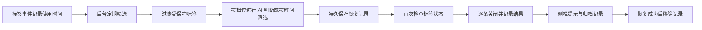

# 标签自动清理：竞品调研与产品方案

调研日期：2026-11-17。状态：第一版已实现，以下保留设计依据及后续扩展方向。

当前实现：AI 三档及按时间模式、分组与清理共用 AI 引擎、首次 24 小时缓冲、预览、网站与本次会话的标签/组保护、暂停、持久归档、搜索、批量恢复、组信息恢复和导出。支持 API、本机 Codex 和 ChatGPT 订阅；端侧模型后台推理暂不支持。恢复采用 URL 重新打开，不依赖 sessions；归档入口使用顶部图标。自然语言检索、长期跨会话的单标签/组保护和浏览器原生会话恢复留待后续。实现使用当前会话内累计激活次数，未实现跨会话频次统计。

## 结论

建议 TabFlow 增加「自动归档」：长期未使用的标签先保存恢复记录，再从浏览器关闭；用户可以在侧栏找回。产品承诺是减少标签堆积，并保留找回入口。

休眠解决资源占用，归档解决标签过多，去重解决重复打开，三者应分别命名。第一版聚焦自动归档，沿用现有手动休眠和手动去重；增加可选的 AI 自动清理，以保守、均衡、积极三档控制 AI 的执行范围。开启后无需逐批确认，AI 决策通过本地约束检查后自动执行。

最关键的限制：恢复网址不等于恢复工作现场。页面内未保存的输入、登录状态和应用运行状态不能承诺完整恢复。

## 调研范围与证据

选取自动关闭、休眠、手动收纳、工作空间四条代表路线。依据官方说明及两个开源项目的当前源码；未安装各插件进行实际体验。商店用户数只用于判断样本代表性，不作为质量排名：本次页面显示 Tab Wrangler 为 5 万用户、Auto Tab Discard 为 10 万用户。[商店：Tab Wrangler](https://chromewebstore.google.com/detail/tab-wrangler/egnjhciaieeiiohknchakcodbpgjnchh)、[商店：Auto Tab Discard](https://chromewebstore.google.com/detail/auto-tab-discard/jhnleheckmknfcgijgkadoemagpecfol)。

| 产品 | 用户面对的设计 | 如何实现 / 证据边界 | 对 TabFlow 的启发 |
| --- | --- | --- | --- |
| Tab Wrangler | 默认 1 小时未访问后关闭；Corral 保存已关闭标签；Lock 管理保护；支持站点保护、最低标签数量、暂停 | 开源：标签事件更新计时，筛选后调用 `tabs.remove`；记录保存在本地；恢复优先尝试 `sessions.restore`，失败则按 URL 新建 | 最直接的参考。自动关闭必须和长期可找回的记录配套；保护和暂停应容易找到 |
| Auto Tab Discard | 按未使用时间休眠；标签仍留在标签栏；提供站点例外、固定和媒体标签等排除选项 | 开源：核心调用 `tabs.discard`，包含重复执行控制和任务队列。源码配置包含 10 分钟周期值，但不据此断言所有商店版本默认值相同 | 休眠不减少标签数量；不要把它包装成同一种清理。TabFlow 自己能显示休眠状态，无须修改网页标题或图标 |
| OneTab | 点击一次把标签收成列表；单条或全部重新打开；可导入导出 | 官方描述的是主动收纳流程；未核验其内部持久化和关闭调用实现 | 可以先用一次手动归档建立信任，再让用户选择自动执行。导出比“累计清理了多少”更有价值 |
| Workona | 按项目组织工作空间；持续保存会话；关闭空间后保存并关闭标签，再打开空间时恢复 | 官方帮助说明产品行为；特定设置下，把非当前空间标签移入最小化窗口临时隐藏，不能把“隐藏”当成已经关闭或释放内存 | 应保留任务上下文和组信息；第一版没必要增加账号、云端空间和隐藏窗口 |

来源：[Tab Wrangler 功能说明](https://github.com/tabwrangler/tabwrangler#features)、[关闭与计时源码](https://github.com/tabwrangler/tabwrangler/blob/main/app/js/tabUtil.ts)、[恢复源码](https://github.com/tabwrangler/tabwrangler/blob/main/app/js/actions/localStorageActions.ts)；[Auto Tab Discard 官方说明](https://webextension.org/listing/tab-discard.html)、[休眠源码](https://github.com/rNeomy/auto-tab-discard/blob/master/v3/worker/core/discard.mjs)、[默认配置源码](https://github.com/rNeomy/auto-tab-discard/blob/master/v3/worker/core/prefs.mjs)；[OneTab 官方说明](https://www.one-tab.com/)、[帮助](https://www.one-tab.com/help)；[Workona Tab Manager 帮助](https://workona.com/help/tab-manager/)。

Chrome 自身已经提供 Memory Saver，并允许设置始终保持活跃的站点。这进一步支持 TabFlow 优先解决“标签堆积与找回”，而非把自动省内存作为主要差异点。[Chrome 官方说明](https://support.google.com/chrome/answer/12929150?hl=en)

## 当前项目对设计的约束

- `src/hooks/useTabsManager.ts` 已有手动关闭、休眠和按完整 URL 去重。现有撤销针对分组，不是持久关闭恢复。
- `src/background/index.ts` 负责自动分组；`src/services/settingsStore.ts` 中自动分组默认开启。因此，“所有分组标签都受保护”会让归档很难发挥作用。
- `src/components/NavTabs.tsx` 已有标签、书签、稍后读三个入口。归档是系统收纳的浏览记录，稍后读是用户主动表达阅读意图，不宜混用。
- 侧栏和独立窗口绑定来源窗口。后台自动任务需要独立于界面生命周期；归档记录可跨窗口查找，恢复目的地仍应遵守来源窗口绑定。
- 当前没有页面正文内容脚本；`public/manifest.json` 的最低版本为 Chrome 120，也没有 `alarms` 和 `sessions` 权限。

## 推荐的第一版体验

### 入口与命名

偏好设置中，在「新标签页自动归类」之后增加「自动清理」，明确说明执行结果是归档后关闭。标签页顶部的更多菜单增加「归档记录」，无需新增第四个主导航。

开启前只显示一个开关及一句说明；开启流程中展示时间、作用范围和候选预览。日常设置保持精简：

```text
自动清理                         [关闭]
将长期未使用的标签保存到归档记录后关闭。

开启后：
清理方式                         [AI 判断 ▾]
清理力度                         [保守] [均衡] [积极]
保护的网站                       [管理]
归档记录                         [查看]

适用于所有普通浏览器窗口。
```

默认关闭；用户开启 AI 自动清理后默认保守档。未配置可用模型时，可以选择「按时间清理」；两种方式必须分别授权，不能在 AI 不可用时悄悄切成按时间关闭。

第一版不提供域名脚本、正则表达式、复杂组合条件和 AI 重要性分数。保护站点使用域名选择器，明确是否包括子域名。

### AI 自动清理的三个档位

AI 三档是可编辑的清理提示词预设，不是固定时长过滤器。保守仅归档明确闲置的临时检索和导航页；均衡可以归档无关的文章与资料；积极可以按闲置主题整组归档。用户可编辑提示词并恢复预设。

AI 候选统一排除最近 1 小时使用的标签，将闲置时间、访问次数、主题活跃情况交给模型判断。按时间模式单独使用 7 / 3 / 1 天门槛。固定、发声、当前选中、网站与会话保护仍由程序强制执行；编辑提示词不会绕过这些保护。提示词修改会使旧结论失效，并重置 24 小时执行缓冲。已有 AI 清理配置升级时也保留 24 小时缓冲。

模型结合标题、去敏网址、使用时间、可用的近期访问频次、组信息和同主题活跃标签，批量判断每个候选是否归档，并为归档集合生成任务名称及简短资料概览。未记录的行为数据视为未知，不能猜测；不读取页面正文时不生成内容结论。用户输入的档位和保护规则属于可信控制信息，网页标题及网址只能作为数据，不能执行其中的指令。

每个自动归档决定必须给出候选 ID 和可核对理由，例如“9 天未使用的搜索结果页”。不使用模型自报的 90%/95% 置信度作为安全阈值。越界 ID、过期快照或无效响应不执行；模型超时、未授权、额度不足时保留候选并显示暂停原因。

产品上提供「预览本档效果」，但预览不是每批执行的前置确认。开启时选定模型和清理作用范围后，后续后台直接执行。切换到更积极的档位时展示影响范围并保留首次执行缓冲。

模型调用与本地扫描分开：每 5 分钟检查候选，AI 最多每小时自动评估一批有变化的候选，给单次候选量设置上限；未变化的结论复用，达到更高闲置阶段或主题活跃状态变化时再评估。不因每次打开新标签调用模型。分组与清理共用当前 AI 引擎，不另存模型或密钥；更换模型或密钥会使旧清理缓存与待执行结果失效。云端最小输入移除 URL query/hash，保护站点不发送；完整恢复 URL 仅存本地。

归档提示显示“AI 已归档 8 个标签”，查看记录可以看到档位、模型和原因。用户恢复后可以选择“仅本次恢复”或“以后保留此网站”；不从一次撤销推导永久规则，不自动更改档位。

### 首次开启

1. 选择清理方式及 AI 档位，展示「将影响所有普通窗口」、所用模型和当前候选数量。
2. 预览候选，按窗口和原分组展示。每条包含标题、站点、未使用时长，可选择「保留此标签」或「保护此网站」。
3. 简短说明：「归档会关闭页面。重新打开可能无法恢复未保存的输入，请先保护编辑器和工作网站。」
4. 开启后保留 24 小时首次执行缓冲，期间允许预览并调整保护；后续可增加「先归档这些」供用户在缓冲期内主动执行一次。

当历史访问时间未知时，显示「开始记录使用时间」，从当前时刻计时，不能伪造已有候选。修改阈值导致大量标签立即过期时，同样给出预览并设置缓冲。

### 归档与反馈

后台每 5 分钟检查一次；AI 模式按上述评估频率产生归档决定，按时间模式依照用户明确设置的时长执行。满足条件的标签先写本地恢复记录，再关闭。实际执行可能晚于阈值；界面不显示精确到秒的倒计时。

侧栏打开时使用不抢焦点的提示：「已归档 8 个标签 [撤销] [查看]」。侧栏未打开时，不为每批归档发送系统通知；下次打开时在归档入口显示新增数量。更多菜单提供「暂停至明天」及「恢复自动归档」。

撤销恢复本批成功关闭的标签。失败的条目继续留在归档里，不能先删除记录再尝试打开。

### 归档记录

- 顶部搜索标题和网址；按归档日期组织，显示原分组及归档原因，例如「7 天未使用」。
- 支持单条打开、选择后批量打开、导出链接和删除记录。批量打开默认在后台创建标签。
- 默认打开到当前侧栏或独立窗口绑定的来源窗口；来源窗口已关闭时，明确提供「在新窗口打开」。
- 尽量恢复组名、组色和相对顺序；原组不存在时新建，避免仅按名称合并到无关分组。分组 ID 不作为跨浏览器重启的稳定标识。
- 单条点击优先切到目标窗口中已存在的完整 URL；不同 query/hash 视为不同网址。始终提供显式的「重新打开副本」。
- 成功恢复后移出待恢复列表，失败时保留。第一版不按天数自动删除归档；设定容量预算，接近容量时提示导出/删除，容量不足则暂停新增归档。禁止静默丢弃最老记录来继续关闭页面。
- 归档保存在本机，不进入 Chrome 设置同步或模型服务；清楚告知卸载扩展会删除本地记录。

## 归档规则与保护

| 条件 | 第一版行为 |
| --- | --- |
| 任一窗口当前选中的标签 | 始终保留，包括未聚焦窗口 |
| 固定标签、正在发声的标签 | 始终保留，静音不意味着允许关闭 |
| 用户选择保留的标签、保护站点 | 保留；站点保护持续生效，单标签保护在本次浏览会话有效 |
| 用户保护的标签组 | 整组保留；自动分组不自动获得保护 |
| 普通分组中的标签 | 按单标签时间判断，归档时保留组信息；折叠不代表允许清理 |
| 加载中、非 HTTP(S)、无痕和非普通窗口 | 跳过 |
| 使用时间未知、刚恢复的标签 | 从现在重新计时，避免立即再次归档 |
| 未超过阈值 | 保留；不为了达到目标数量提前关闭 |

时间定义为“距上次结束前台使用或发生用户导航的时长”。长时间阅读当前页不会导致切走后立刻归档；自动刷新不算重新使用。设备休眠和浏览器关闭可以计入自然时间，但恢复运行后至少留 10 分钟缓冲，不补执行多轮清理。

固定、发声等字段无法覆盖所有会议、屏幕共享、下载和编辑器。第一版不承诺自动识别未保存表单；`autoDiscardable` 也只是浏览器的自动丢弃标志，不能当作“页面没有未保存输入”的证明。若将来增加页面检测，需要明确额外权限和可检测范围，检测也不能保证覆盖所有应用。[Chrome Tabs API](https://developer.chrome.com/docs/extensions/reference/api/tabs)

## 实现建议



1. **后台执行**：增加 `alarms` 权限，在 Service Worker 注册监听；开启功能时建立周期任务，每次后台初始化检查任务是否仍在。关闭侧栏后继续工作，不依赖 React 定时器，也不为该功能保持后台常驻。设备唤醒后闹钟可能补触发，需要应用恢复缓冲。[Chrome Alarms API](https://developer.chrome.com/docs/extensions/reference/api/alarms)
2. **可靠计时**：监听标签创建、激活、导航、移除及窗口切换，记录必要时间。Chrome 的 `lastAccessed` 自 121 才提供，而项目支持 120，因此只能作为可用时的辅助信息。使用 `storage.session` 保存本次浏览会话的 tab ID 状态以跨后台休眠保留；浏览器重启后基于可用访问时间重建，无法可靠判断就重新计时，宁可晚归档。[Chrome Tabs API](https://developer.chrome.com/docs/extensions/reference/api/tabs#property-Tab-lastAccessed)
3. **数据分开存储**：沿用现有设置更新通道；启用状态、缓冲及暂停时间只在本机生效，避免其他设备意外开启。恢复记录写 `storage.local`，包含 URL、标题、归档时间/原因、批次、来源窗口/组元数据和相对顺序；不保存网页正文。第一版无需引入独立后端。
4. **先保存，再关闭**：本地写入成功才进入关闭流程；关闭前重查 URL、窗口、激活状态及保护规则。逐条处理，单条失败不阻断其他标签。少量处理中状态用于区分“已保存但未关闭”和“已归档”；后台重启后核对，宁可保留重复记录，也不能先关闭后丢恢复入口。Chrome API 不提供原子化“检查并关闭”，需承认极短竞态窗口并进行设备验证。
5. **恢复能力分级**：持久 URL 记录是基础能力。可选增加 `sessions`，尝试浏览器原生恢复，失败时退回 URL 打开；不能把它作为长期归档库，最近会话查询上限为 25 项。第一版可以只提供 URL 恢复，文案必须如实表述。[Chrome Sessions API](https://developer.chrome.com/docs/extensions/reference/api/sessions)
6. **避免与自动分组冲突**：归档恢复期间由后台标记新标签，待原分组恢复后再解除标记，避免现有 `onUpdated` 自动分组抢先处理。组保护由用户显式指定，组重建后需要重建保护关联。

建议实现落点：新增独立的后台归档模块和存储服务，接入 `src/background/index.ts`；设置 UI 复用 `SettingsModal.tsx`，归档视图由 `App.tsx` 打开。现有普通关闭行为不自动变成归档，避免收集超出用户预期的浏览记录。

## 分阶段范围与验收

第一版包含：候选预览、显式开启自动归档、AI 自动清理三档及按时间模式、标签/站点/组保护、暂停、持久归档与恢复、导出。高级自定义规则、自动去重、云同步和整套工作空间均不进入本轮。

必要验证围绕真实风险，优先使用现有模拟 Chrome API 测试设施，并补充浏览器实测：

- 固定、活跃、发声、保护站点/组不会被关闭；刚切到候选页或导航到其他 URL 时，旧候选不应继续执行。
- 存储失败不关闭；部分关闭失败不虚报成功；后台在写入后中断仍留有恢复记录。
- 关闭侧栏、后台休眠、浏览器重启及设备唤醒后的行为符合计时和缓冲约定。
- 恢复不会立刻再次归档；来源窗口消失或原组消失时仍能找回；自动分组不会抢占恢复分组。
- 手动试用包含长时间阅读、静音媒体、文档编辑、多窗口及批量恢复；未保存内容损失属于发布前必须评估的风险。
- 同一批浏览场景分别验证三档，检查页面类型范围与保留上下文的差异；模型无法判断、响应越界、输出过期、调用失败时不会关闭标签。预设独立的人工判断样本评估误归档，不把模型输出本身当作正确答案。

产品验证关注“归档后很快又被恢复的比例”、保护操作的频率、找回成功率及持续启用率。先通过少量自愿试用和本地结果核验判断，不因设计研究新增遥测。若频繁找回，优先调整阈值或保护机制，不追求清理数量。

## 额外发现

1. **自动分组会削弱分组豁免的效果 →** 分组在 TabFlow 中是整理结果，未必代表重要性 → 保护必须由用户表达，不能默认保护所有组。
2. **恢复链接无法撤销未保存内容的损失 →** “随时恢复”容易形成错误预期 → 首次启用明确恢复边界，以候选预览和站点保护建立信任。
3. **Chrome 已有自动省内存能力 →** 单纯增加休眠设置的差异有限 → 优先完成“减少堆积、保留上下文、容易找回”的闭环。
